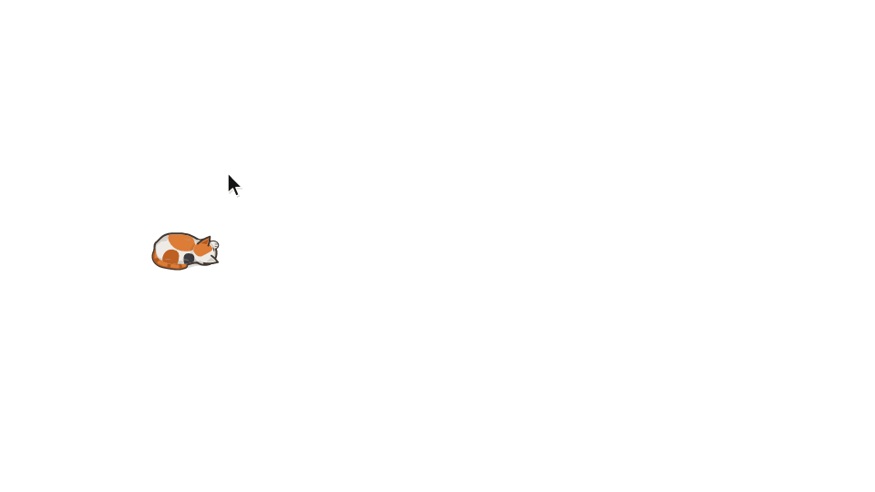

# Catsor

A small cat that lives on your desktop. It's drawn from above, animated procedurally, and wanders after your mouse cursor. It sits, grooms, flops over, falls asleep, pounces when you wiggle the cursor like a laser pointer, and sprints when you shake the mouse. You can also feed it, which keeps your screen awake.

Runs on **Linux (X11)** and **Windows**. It's a single binary written in Rust, with no GUI toolkit.



### Coats and poses


## Install

Download a prebuilt binary from the [Releases](https://github.com/ozanenginoglu/catsor/releases) page:

- **Linux:** `catsor-<version>-x86_64-unknown-linux-musl.tar.gz` is a fully static binary that runs on any x86_64 distro. Extract it and run `./catsor`. To get a "Catsor" entry with an icon in your app launcher, put the binary on your `PATH` and install the desktop entry and icon from the archive:

  ```sh
  install -Dm644 catsor.desktop ~/.local/share/applications/catsor.desktop
  install -Dm644 catsor.png ~/.local/share/icons/hicolor/256x256/apps/catsor.png
  ```
- **Windows:** `catsor-<version>-x86_64-pc-windows-msvc.zip`. Extract it and run `catsor.exe`. The binary isn't code-signed, so SmartScreen may warn on first launch. Choose *More info → Run anyway*.

Each release comes with a `SHA256SUMS` file and GitHub build provenance, which you can check with `gh attestation verify <file> --repo ozanenginoglu/catsor`.

With a Rust toolchain you can also install from source:

```sh
cargo install --git https://github.com/ozanenginoglu/catsor
```

## Build

```sh
cargo build --release
./target/release/catsor
```

On Linux, the X11 libraries come in through `x11rb` (pure Rust), so you don't need system `-dev` packages. On Windows, `build.rs` embeds `assets/catsor.ico` into `catsor.exe`. The MSVC toolchain needs nothing extra. The GNU (MinGW) toolchain uses `windres` from MinGW, and without it the exe is built without an icon (with a warning).

## Requirements

| | Linux / X11 | Windows |
|---|---|---|
| Transparency | A compositor (e.g. **picom**) and a 32-bit ARGB visual | Built in (layered windows) |
| Tray icon | A tray that supports XEmbed `_NET_SYSTEM_TRAY` (trayer, stalonetray, polybar, xfce4-panel, …) | Notification area |
| Feeding / keep-awake | `systemd-inhibit` (optional) | — |

Without a compositor the window's background shows up black. If there's no tray, Catsor keeps trying to dock every ~2 s, and `--no-tray` turns the tray off completely. Native Wayland is not supported.

## Usage

```
catsor [OPTIONS]

  -c, --coat <COAT>                 calico | brown | charcoal | tuxedo | silver
  -s, --scale <SCALE>               size multiplier, 0.5–2.5 (1.0 ≈ 38 px body)
  -t, --temperament <TEMPERAMENT>   balanced | playful | lazy | aloof | realistic
      --no-tray                     don't create a tray icon
      --fps <FPS>                   target frame rate (default 60, min 15)
      --preview-sheet <PATH>        render a PNG of all coats and poses, then exit
```

`--coat`, `--scale` and `--temperament` override your saved preferences **and are saved as the new defaults**.

The cat window ignores the mouse entirely, so clicks and hovers go straight to whatever is underneath it. You control it from the tray icon.

### Tray menu

Left- or right-click the tray icon to open the menu. Press Esc or click outside it to close.

| Section | Items |
|---|---|
| **Appearance** | **Coat** row: click to cycle Calico → Brown → Charcoal → Tuxedo → Silver. **Size** row: click to cycle Compact 0.8× → Normal 1.0× → Large 1.35× → Extra Large 1.75× (a `--scale` outside these shows as "Custom"). **Temperament** row: click to cycle Balanced → Playful → Lazy → Aloof → Realistic (see [behavior.md](docs/behavior.md#temperaments)) |
| **Feed (keep awake)** | 15 m · 30 m · 1 h · 2 h · Unlimited. While feeding, a **Stop Feeding** row appears (choosing the active preset again also stops) |
| **Behaviors** | Follow Cursor · Playful Hunting (pounce/zoomies/tail-chase/paw-bat) |
| | Show Cat (checkbox) · Start on Login (checkbox) · About Catsor (shows the version, opens the GitHub page) · Quit Catsor |

### Things to try

- **Wiggle the cursor back and forth** about 85–230 px from the cat. It crouches, wiggles its butt, and pounces.
- **Shake the mouse quickly left and right.** The cat gallops over to the cursor.
- **Shake the mouse right over the cat** to shoo it off. It goes its own way: it wanders around the screen, naps, and keeps away from the cursor. Shake the mouse again (anywhere) to call it back. It gallops over and goes back to following you.
- **Turn off Follow Cursor** in the tray menu and the cat roams the same way, until you turn it back on.
- **Leave it alone.** It sits, then lies down, then curls up and sleeps.

### Feeding mode (keep-awake)

When you pick a feed preset, a food bowl sticks to your cursor. **Left-click** to put it down. Right-click or Esc cancels. The cat walks to the bowl and eats until the timer runs out, then grooms itself and goes back to following you. While it's walking to the bowl or eating, Catsor keeps the session and screen awake. It only asks the OS not to idle (no simulated mouse moves, clicks or key presses), so chat apps can still show you as away. Details are in [platform-notes.md](docs/platform-notes.md#keep-awake-feeding-mode).

### Start on login

**Start on Login** registers the running executable to launch when you log in. Your saved preferences still apply at startup.

- Linux: writes `$XDG_CONFIG_HOME/autostart/catsor.desktop` (otherwise `~/.config/autostart/`). Desktop environments and session managers that follow the XDG autostart spec run it, such as GNOME, KDE and XFCE, or `dex -a`. Bare window managers like xmonad don't read it, so start Catsor from your startup hook instead.
- Windows: adds a `catsor` value under `HKCU\Software\Microsoft\Windows\CurrentVersion\Run`. It shows up in Task Manager's Startup tab, and the checkbox respects it being disabled there.

If you move the binary, turn the option off and back on to update the path.

## Configuration

Preferences are saved automatically whenever you change them in the tray. They're stored at:

- Linux: `$XDG_CONFIG_HOME/catsor/config.toml`, otherwise `~/.config/catsor/config.toml`
- Windows: `%APPDATA%\catsor\config.toml` (then `%LOCALAPPDATA%`, then `%USERPROFILE%\AppData\Roaming`)

```toml
# Catsor user preferences
coat = "calico"
temperament = "balanced"
scale = 1.00
follow_cursor = true
playful_quirks = true
```

Lines that are unknown or invalid are skipped, and the default is used for those settings. Feeding sessions and hide/show are not saved; they reset when Catsor restarts.

## Development

```sh
cargo test                       # behavioral simulation tests
cargo test rapid_left_right      # one test by name
cargo run -- --preview-sheet /tmp/sheet.png --scale 1.5    # check rendering changes visually
cargo test regenerate_app_icons -- --ignored               # rewrite assets/catsor.{ico,png} after changing the tray icon
cargo run -- --preview-sheet docs/preview.png --scale 1.5  # rewrite the README coats-and-poses picture
cargo test regenerate_demo_gif -- --ignored                # rewrite the README demo GIF (needs ffmpeg)

# Type-check the Windows backend from Linux
RUSTFLAGS="--cfg windows_check" cargo check --target-dir target/wincheck
```

## Documentation

- [docs/behavior.md](docs/behavior.md): the activity state machine and temperaments
- [docs/animation.md](docs/animation.md): body model, gaits, posture and rendering layers
- [docs/platform-notes.md](docs/platform-notes.md): X11 and Win32 implementation details and the reasons behind them

## License

Licensed under the [Apache License, Version 2.0](LICENSE). If you redistribute Catsor or a work based on it, include the [NOTICE](NOTICE) file as the license requires.
