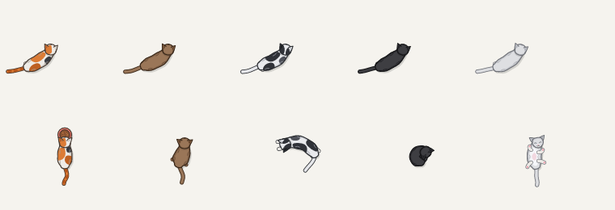
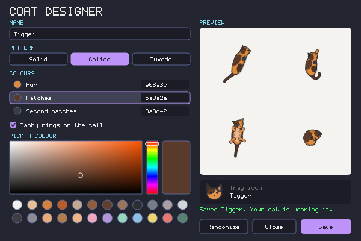

# Catsor

A small cat that lives on your desktop. It's drawn from above, animated procedurally, and wanders after your mouse cursor. It sits, grooms, flops over, falls asleep, pounces when you wiggle the cursor like a laser pointer, and sprints when you shake the mouse. You can also feed it, which keeps your screen awake, and give it company: more cats, or kittens of its own that chase, wrestle and get carried back by the scruff.

Runs on **Linux (X11)** and **Windows**. It's a single binary written in Rust, with no GUI toolkit.


### Coats and poses



## Install

Download a prebuilt binary from the [Releases](https://github.com/ozanenginoglu/catsor/releases) page:

- **Linux:** `catsor-<version>-x86_64-unknown-linux-musl.tar.gz` is a fully static binary that runs on any x86_64 distro. Extract it and run `./catsor`. To get a "Catsor" entry with an icon in your app launcher, put the binary on your `PATH` and install the desktop entry and icon from the archive:

  ```sh
  install -Dm644 catsor.desktop ~/.local/share/applications/catsor.desktop
  install -Dm644 catsor.png ~/.local/share/icons/hicolor/256x256/apps/catsor.png
  ```
- **Windows:** `catsor-<version>-x86_64-pc-windows-msvc.zip`. Extract it and run `catsor.exe`. The binary isn't code-signed, so SmartScreen may warn on first launch. Choose *More info → Run anyway*.

Each release comes with a `SHA256SUMS` file and GitHub build provenance, which you can check with `gh attestation verify <file> --repo ozanenginoglu/catsor`.

With a Rust toolchain you can also install from source:

```sh
cargo install --git https://github.com/ozanenginoglu/catsor
```

## Build

```sh
cargo build --release
./target/release/catsor
```

On Linux, the X11 libraries come in through `x11rb` (pure Rust), so you don't need system `-dev` packages. On Windows, `build.rs` embeds `assets/catsor.ico` into `catsor.exe`. The MSVC toolchain needs nothing extra. The GNU (MinGW) toolchain uses `windres` from MinGW, and without it the exe is built without an icon (with a warning).

## Requirements

| | Linux / X11 | Windows |
|---|---|---|
| Transparency | A compositor (e.g. **picom**) and a 32-bit ARGB visual | Built in (layered windows) |
| Tray icon | A tray that supports XEmbed `_NET_SYSTEM_TRAY` (trayer, stalonetray, polybar, xfce4-panel, …) | Notification area |
| Feeding / keep-awake | `systemd-inhibit` (optional) | — |

Without a compositor the window's background shows up black. If there's no tray, Catsor keeps trying to dock every ~2 s, and `--no-tray` turns the tray off completely. Native Wayland is not supported.

## Usage

```
catsor [OPTIONS]

  -c, --coat <COAT>                 the first cat's coat: calico | brown | charcoal | tuxedo | silver | random,
                                    or the name of a custom coat (see Custom coats)
  -s, --scale <SCALE>               size multiplier, 0.5–2.5 (1.0 ≈ 38 px body)
  -t, --temperament <TEMPERAMENT>   the first cat's temperament: balanced | playful | lazy | aloof | realistic
      --no-tray                     don't create a tray icon
      --fps <FPS>                   target frame rate (default 60, min 15)
      --preview-sheet <PATH>        render a PNG of all coats and poses (or only --coat), then exit
      --print-coat                  print the current coat (or --coat) as a coats.toml entry, then exit
      --design-coat                 open the coat designer at startup (handy with --no-tray)
```

`--coat`, `--scale` and `--temperament` override your saved preferences **and are saved as the new defaults**.

The cat windows ignore the mouse entirely, so clicks and hovers go straight to whatever is underneath it. You control it from the tray icon.

### Tray menu

Left- or right-click the tray icon to open the menu. Press Esc or click outside it to close.

| Section | Items |
|---|---|
| **Cats** | One row per cat (a coat swatch, the name, "(kitten)" for kittens). Click one to open its page, below. **Add Cat** brings in a new cat with a random coat; it walks in from the nearest screen edge (up to 6 cats). **Size** row: click to cycle Compact 0.8× → Normal 1.0× → Large 1.35× → Extra Large 1.75× for every cat (a `--scale` outside these shows as "Custom") |
| **Feed (keep awake)** | 15 m · 30 m · 1 h · 2 h · Unlimited. While feeding, a **Stop Feeding** row appears (choosing the active preset again also stops) |
| **Behaviors** | Follow Cursor · Playful Hunting (pounce/zoomies/tail-chase/paw-bat, and cats playing with each other). Each is one switch for every cat |
| | Show Cat(s) (checkbox) · Start on Login (checkbox) · About Catsor (shows the version, opens the GitHub page) · Quit Catsor |

A cat's page (**Back** returns to the main page):

| Row | What it does |
|---|---|
| **Rename...** | Opens a field in the menu: type the new name (up to 16 letters, digits, spaces and `.!()&-/:`), then Enter or **Save Name**; Esc goes back. The cat keeps its bonds and kittens |
| **Coat** | Click to cycle Calico → Brown → Charcoal → Tuxedo → Silver, then your [custom coats](#custom-coats) |
| **Random Coat** | Rolls a new random coat (see below) |
| **Design Coat...** | Opens the [coat designer](#coat-designer) for this cat |
| **Temperament** | Click to cycle Balanced → Playful → Lazy → Aloof → Realistic (see [behavior.md](docs/behavior.md#temperaments)) |
| **Add Kitten** | Grown cats only: adds a smaller, Playful kitten with this cat as its mother, with a coat that takes after hers. It walks in behind her |
| **Grows Up** | Kittens only: the kitten grows into a grown cat over 30 days (shows how many are left). Off by default |
| **Remove** | Sends the cat away (shown while there's more than one cat) |

### Things to try

- **Wiggle the cursor back and forth** about 85–230 px from the cat. It crouches, wiggles its butt, and pounces.
- **Shake the mouse quickly left and right.** The cat gallops over to the cursor.
- **Shake the mouse right over the cat** to shoo it off. It goes its own way: it wanders around the screen, naps, and keeps away from the cursor. Shake the mouse again (anywhere) to call it back. It gallops over and goes back to following you.
- **Turn off Follow Cursor** in the tray menu and the cat roams the same way, until you turn it back on.
- **Leave it alone.** It sits, then lies down, then curls up and sleeps.
- **Add a second cat** (or a kitten). Each cat finds its own spot round the cursor, and they keep out of each other's way. They watch each other, hold their tails up for friends, and grow fond of each other the more time they spend together. Shake a kitten off and watch its mother fetch it back, sometimes carrying it by the scruff. Let a kitten fall asleep, then lead its mother far away: she goes back for it and carries it over, limp in her mouth. Leave them be and they greet each other (strangers sniff each other round in a circle; friends rub against each other), groom each other, curl up together to sleep, and a kitten comes to knead and nap against its mother.
- **Let them play** (with Playful Hunting on). Kittens and Playful cats chase each other round the cursor, wrestle, and pounce on each other's tails; a mother twitches her tail for her kitten to pounce on. A grown cat pestered by a kitten soon swats it or walks off, play that gets too rough ends with one puffed up in a short standoff before both groom it off, and one cat's zoomies set off its friends. Wiggle the laser dot at several cats and only one gets to hunt it; the others twitch their tails, and a kitten may go for the winner's tail instead. At the bowl, a pushy cat may push in beside the one eating, which gives way or swats it.

### Feeding mode (keep-awake)

When you pick a feed preset, a food bowl sticks to your cursor. **Left-click** to put it down. Right-click or Esc cancels. The cat walks to the bowl and eats until the timer runs out, then grooms itself and goes back to following you. With several cats there's still one bowl: they take turns of up to 2.5 minutes, kittens first, while the others sit round the bowl and wait. While it's walking to the bowl or eating, Catsor keeps the session and screen awake. It only asks the OS not to idle (no simulated mouse moves, clicks or key presses), so chat apps can still show you as away. Details are in [platform-notes.md](docs/platform-notes.md#keep-awake-feeding-mode).

### Start on login

**Start on Login** registers the running executable to launch when you log in. Your saved preferences still apply at startup.

- Linux: writes `$XDG_CONFIG_HOME/autostart/catsor.desktop` (otherwise `~/.config/autostart/`). Desktop environments and session managers that follow the XDG autostart spec run it, such as GNOME, KDE and XFCE, or `dex -a`. Bare window managers like xmonad don't read it, so start Catsor from your startup hook instead.
- Windows: adds a `catsor` value under `HKCU\Software\Microsoft\Windows\CurrentVersion\Run`. It shows up in Task Manager's Startup tab, and the checkbox respects it being disabled there.

If you move the binary, turn the option off and back on to update the path.

## Configuration

Preferences are saved automatically whenever you change them in the tray. They're stored at:

- Linux: `$XDG_CONFIG_HOME/catsor/config.toml`, otherwise `~/.config/catsor/config.toml`
- Windows: `%APPDATA%\catsor\config.toml` (then `%LOCALAPPDATA%`, then `%USERPROFILE%\AppData\Roaming`)

```toml
# Catsor user preferences
scale = 1.00
follow_cursor = true
playful_quirks = true

[[cat]]
name = "Luna"
coat = "calico"
temperament = "balanced"

[[cat]]
name = "Pip"
coat = "litter:00c0ffee:calico"
temperament = "playful"
size = 0.60
kitten = true
mother = "Luna"
grows_up = true
born = 1793099157
```

Lines that are unknown or invalid are skipped, and the default is used for those settings. Feeding sessions and hide/show are not saved; they reset when Catsor restarts.

Each `[[cat]]` table is one cat, up to 6. `name` identifies the cat and must be unique. `size` (optional, 0.4–1.5) multiplies `scale`; kittens added from the tray get 0.6. `mother` must name another cat that isn't a kitten, otherwise it's ignored. A kitten's mother lets it eat first. Kittens nap often but briefly, play more, and stay close to their mother; if one wanders off, its mother goes and fetches it. With `grows_up = true` a kitten grows into a grown cat over 30 days from `born` (Unix seconds, filled in for you), and then stops being a kitten but keeps its mother. A config from an older version, with `coat` and `temperament` at the top level, is read as a single cat named Luna.

How well the cats know and like each other is kept in `bonds.toml` in the same directory, so friendships carry across restarts.

`coat` is a built-in coat, the name of a custom coat, or `random:<seed>` for a random coat, so the same random cat comes back after a restart. A kitten added from the tray gets `litter:<seed>:<mother's coat>`, a coat rolled from its mother's: her colours, about as much white as she has, and now and then a diluted, greyer kitten.

### Random coats

**Random Coat** in the tray menu rolls a new cat from simplified real cat colour genetics. The base colour is black, chocolate or cinnamon, their dilute versions (blue, lilac, fawn), or ginger or cream. A cat may also be tortoiseshell, and may have no white, tuxedo markings or bicolor/calico white. Ginger cats always get tabby rings on the tail. The tray shows the result's name, such as *Blue tuxedo* or *Dilute calico*. If you want to keep one and tweak it, run `catsor --print-coat` while it's selected and paste the output into `coats.toml`.

### Coat designer

**Design Coat...** in the tray menu opens a window for making your own coat, starting from the one your cat is wearing:



- **Name** it (up to 22 characters).
- Pick a **pattern**: Solid, Calico (patches plus a patch-coloured tail), or Tuxedo (a mask and a saddle).
- Click a **colour row** (fur, patches, second patches) to choose which colour you're editing. Then use the picker square and hue strip, click a quick pick (the top row holds real cat colours), or click the hex value and type one.
- Toggle **tabby rings** on the tail.
- **Randomize** rolls a random coat (the name is kept).
- If the coat has colours you [hand-tuned in `coats.toml`](#custom-coats), the preview includes them and the tabby row shows how many there are. Saving keeps them. **Reset** drops them, so every colour is derived from the designer's colours again.

The preview shows the cat walking, sitting, belly-up and asleep, plus its tray icon, and updates as you edit. **Save** (or Enter) writes the coat to `coats.toml` and puts it on your cat. If the cat was already wearing a custom coat, saving updates that coat, including a rename; otherwise it adds a new one. Esc or **Close** closes the window without saving.

### Custom coats

Custom coats live in `coats.toml`, in the same directory as `config.toml`. You can make them with the designer, write them by hand, or both. Custom coats are added to the end of the tray's **Coat** cycle, and `--coat <name>` selects one. **Edits are picked up live**: save the file and the running cat changes within a second. When the designer saves, it only rewrites its own keys (`name`, `pattern`, `base`, `patch`, `spot`, `tail_rings`) in that coat's entry. Your comments, other coats and any extra overrides you added by hand are kept (unless you pressed **Reset** in the designer).

```toml
[[coat]]
name = "Marmalade"         # shown in the tray (up to 22 characters)
base = "#e08a3c"           # the only other required key
tail_rings = "#b0602a"     # tabby rings on the tail

[[coat]]
name = "Oreo"
pattern = "tuxedo"         # solid (default) | calico | tuxedo
base = "#f6f6f4"           # fur colour
patch = "#1e1e22"          # mask and saddle colour

[[coat]]
name = "Smoke & Peach"
pattern = "calico"
base = "#c9cdd6"
patch = "#f0b48a"          # large patches, ears and tail
spot = "#5a5f6e"           # the smaller second patch colour
```

Colours are `"#rrggbb"`, or `"#rrggbbaa"` with alpha. Any colour you leave out is derived from `base`, `patch` and `spot`. To fine-tune a coat you can override `shade`, `outline`, `crease`, `ears`, `ear_inner`, `nose`, `paws`, `belly`, `tummy`, `chin`, `patch_shade`, `tail`, `tail_shade`, `tail_rings` (a colour, `"auto"` for rings a shade darker than the tail, or `"none"`) and `eyes` (tray icon). Overriding a colour also moves the colours derived from it: `tail` sets the tail's shading, `shade` sets the tail shading on solid and tuxedo coats, and `outline` sets the nose and the tray icon's outline and eyes, unless you override those too. The easiest starting point is an existing coat with every colour filled in:

```sh
catsor --coat tuxedo --print-coat >> ~/.config/catsor/coats.toml   # then rename it and edit
catsor --coat "Oreo" --preview-sheet /tmp/oreo.png                 # see it in every pose
```

Entries with a missing name or base, a bad colour, a duplicate name, or a name taken by a built-in coat are skipped with a warning on stderr. If the selected custom coat disappears from the file, the cat falls back to Calico.

## Development

```sh
cargo test                       # behavioral simulation tests
cargo test rapid_left_right      # one test by name
cargo run -- --preview-sheet /tmp/sheet.png --scale 1.5    # check rendering changes visually
cargo test regenerate_app_icons -- --ignored               # rewrite assets/catsor.{ico,png} after changing the tray icon
cargo run -- --preview-sheet docs/preview.png --scale 1.5  # rewrite the README coats-and-poses picture
cargo test regenerate_demo_gif -- --ignored                # rewrite the README demo GIF (needs ffmpeg)

# Type-check the Windows backend from Linux
RUSTFLAGS="--cfg windows_check" cargo check --target-dir target/wincheck
```

## Documentation

- [docs/behavior.md](docs/behavior.md): the activity state machine and temperaments
- [docs/animation.md](docs/animation.md): body model, gaits, posture and rendering layers
- [docs/platform-notes.md](docs/platform-notes.md): X11 and Win32 implementation details and the reasons behind them

## License

Licensed under the [Apache License, Version 2.0](LICENSE). If you redistribute Catsor or a work based on it, include the [NOTICE](NOTICE) file as the license requires.
