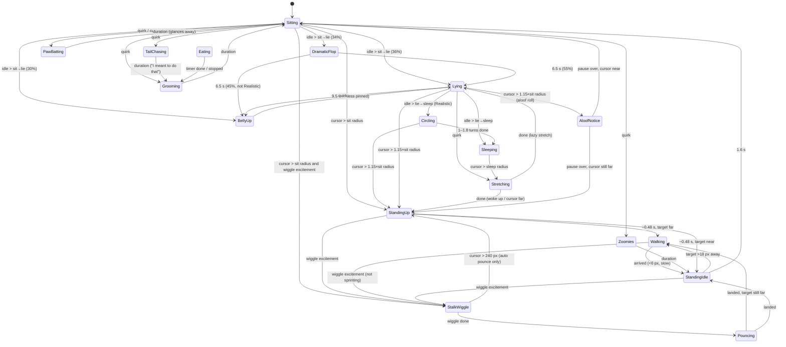

# Behavior

All behavior lives in `CatSim::update` in `src/cat/behavior.rs`. It's a single `Activity` state machine that runs once per frame on the cursor position and `dt`. Every distance listed below is in **unscaled pixels** and gets multiplied by `cat.scale` in the code.

## The pieces of state that drive decisions

| Field | Meaning |
|---|---|
| `raw_cursor` | This frame's cursor position. Used for wiggle and shake detection |
| `smooth_cursor` | Low-pass filtered cursor (rate 6.0/s, or 8.5/s while sprinting). The cat walks toward this, so small jitter from typing or clicking is ignored |
| `rest_target` | Where the cat is heading: a point `stop_radius` short of the cursor, so the cat doesn't cover the pointer |
| `wake_anchor` | Set after an eating session, a groom or a test trigger. While it's set, "distance to cursor" means **how far the cursor has moved since the anchor**, not how far the cat is from it. That's why the cat stays put after eating even when the cursor is across the screen, until you actually move the mouse |
| `idle_time` | Builds up while resting and is **not** reset between Sitting → Lying, so the "lie → sleep" time counts total idle time |
| `play_excitement` | Built up by laser-pointer-style wiggles. Leads to a pounce |
| `shake_energy` / `sprinting` | Built up by fast left-right mouse shakes. Leads to a gallop |
| `roaming` | Set by a shake right over the cat, or while Follow Cursor is off. The cat ignores the cursor, wanders on its own and keeps away from it |
| `pinned_rest` | Set only by the test-only `BellyUp` trigger. Keeps BellyUp from timing out |

If **Follow Cursor** is off, the cat is always roaming (see [Shake over the cat → roaming](#shake-over-the-cat--roaming)): it lives its own life, wanders and keeps away from the cursor, and shakes are ignored.

## State diagram

Not shown in the diagram: Grooming, PawBatting and TailChasing all go to `StandingUp` when the cursor moves past their wake radius (1.05×, 1.0× and 1.2× the sit radius). A sprint forces any state into `Walking`. While roaming, "cursor" in the diagram means the cat's own wander target (see [Shake over the cat → roaming](#shake-over-the-cat--roaming)).

## Wake radii

| Situation | Wakes when the cursor is farther than |
|---|---|
| Walking stops at (`stop_radius`) | 38 × stop mult |
| Sitting, PawBatting | 72 × sit mult |
| Grooming | 72 × sit mult × 1.05 |
| Lying, DramaticFlop, BellyUp | 72 × sit mult × 1.15 |
| TailChasing | 72 × sit mult × 1.2 |
| Sleeping | 92 × sleep mult |

## Temperaments

| | stop mult | sit mult | sleep mult | sit→lie | lie→sleep | aloof chance | speed | quirk rate |
|---|---|---|---|---|---|---|---|---|
| **Balanced** | 1.00 | 1.00 | 1.00 | 12 s | 28 s | 28% | 1.00× | 1.00× |
| **Playful** | 0.85 | 0.80 | 0.80 | 18 s | 40 s | 8% | 1.22× | 1.65× |
| **Lazy** | 1.05 | 1.55 | 1.60 | 5.5 s | 12 s | 45% | 0.78× | 0.55× |
| **Aloof** | 1.35 | 1.30 | 1.25 | 11 s | 26 s | 65% | 0.90× | 0.75× |
| **Realistic** | 1.00 | 1.00 | 1.10 | 45 s | 120 s | 35% | own cruise, 1.00× sprint | 0.45× |

**Realistic** aims for real-cat pacing rather than a personality. The cat is ~45 px long, so 1 px is about 1 cm. It walks at 66 px/s (~0.65 m/s at ~1.6 strides/s, a relaxed cat walk) instead of 104, and trots at up to 135 px/s only toward distant targets. It settles slowly and fidgets rarely. Its sprint speed is the same as Balanced. The other temperaments scale a brisker walk and trot (104/152 px/s) by their speed multiplier, which also scales the sprint.

Temperament also sets how fast wiggles build `play_excitement`: each counted reversal adds 0.1 × Playful 2.5, Balanced 1.8, Realistic 1.5, Aloof 1.1 or Lazy 0.9. "Aloof chance" is the probability that a lying cat first goes into `AloofNotice` (a 0.22–0.38 s ear-flick pause) before getting up. It only applies when the cursor is within 210 px.

## Cursor gestures

### Laser-pointer wiggle → pounce

`track_wiggle_strokes` splits cursor movement into *strokes*. Movement is collected until it covers 4 px, which gives a direction that doesn't depend on the frame rate. A new stroke starts when that direction reverses (dot product < −0.25 with the stroke's direction). A stroke is *fast* if it is 8–150 px long and peaked above 250 px/s. A pause of 0.25 s, or a single-frame jump of 75 px or more, forgets the stroke so far.

A reversal counts toward `play_excitement` only if **all** of these are true:
- Playful Hunting is on.
- It ends a fast stroke that itself began by reversing out of a fast stroke. So a back-and-forth flick counts, but an aimed move that overshoots and corrects back does not: it has only one fast stroke, and the correction is slow and short.
- The cursor is 75–230 px from the cat's head.

A jump of 75 px or more, or a cursor 230 px or more from the head, resets excitement to 0. Otherwise excitement decays at 0.4/s. Once excitement is above **0.55** and both the raw and the smoothed cursor are 85–230 px away, a Sitting, StandingUp, StandingIdle or Walking (not sprinting) cat goes into `StalkWiggle`, a low crouch with flattened ears. Walking and StandingIdle matter because a cursor moved out to pounce range wakes a sitting cat before a wiggle there has built enough excitement; the cat then stops on its way over and crouches. A Balanced cat needs under a second of a 4 Hz wiggle. The crouch lasts 0.6–0.85 s, or 1.4–2.4 s for Realistic. The cat holds a still stare for the first 30% of the crouch, then the butt wiggle fades in: weight shifting between the hind paws at about 3 Hz, right up to the launch. Then it goes into `Pouncing`, a leap of at most 180 px (90 px, about two body lengths, for Realistic; a cat with farther to go lands short and walks the rest). The leap follows `pounce_travel`, a trapezoidal speed profile: a hard push-off over the first 20%, steady flight, then braking over the last 25% as the forepaws land.

> The reversal requirement is deliberate (commit `2c02ff9`). Before it, a sudden point-to-point mouse move counted as excitement and made the cat do a straight-line pounce across the screen. Normal moves must always lead to a walk.

### Left-right shake → gallop

- A *horizontal step* is |dx| > 2.5 px, |dx| ≥ 0.75·|dy|, and vx > 180 px/s.
- Steps in the same direction add up into a *stroke*. When the direction reverses, the previous stroke counts if it covered ≥ 12 px and peaked above 240 px/s. Each counted stroke adds **0.68** `shake_energy` (capped at 2.0).
- Energy decays at 1.35/s. The stroke resets after 0.25 s with no horizontal steps, or after a large vertical move.
- At `shake_energy ≥ 1.0`, so about two quick reversals, `sprinting` turns on. The exception is a shake at pounce range: with Playful Hunting on, if both the raw and the smoothed cursor are 75–230 px from the head, the energy is used up and nothing starts (`shake_is_laser_play`). A side-to-side wiggle there is laser play for the stalk above, not a call to come over. Any state is forced into `Walking` with turning and acceleration tuned for a gallop, and `gallop_weight` blends in (see [animation.md](animation.md#gaits)). Sprinting ends once the cat has stopped and its energy has run out. Shakes are ignored while the cat is eating or when Follow Cursor is off.

### Shake over the cat → roaming

If the shake triggers while the smoothed cursor is within 18 px (`SHAKE_OFF_RADIUS`) of the cat's spine (head to tail base), and the cat isn't already sprinting, the cat is shaken off instead of sprinting: `roaming` turns on. Only the smoothed cursor counts, because it sits near the middle of the shake. The raw cursor swings ±40 px, so a shake right in front of a resting cat (the cursor sits a stop radius, ~38 px, from its head) would brush its head and shoo it when the user meant to call it. A crouch that hasn't launched yet is called off. A pounce already in the air just lands. Shakes are then ignored (`shake_lockout`) until the cursor has stopped making fast horizontal steps for 0.4 s, so carrying on with the same shake can't call the cat straight back.

While roaming, the state machine runs as usual but is driven by `roam_target` instead of the cursor. The cursor distance that wakes the cat is 0. While the cat has somewhere to go, `Steering::roam_errand` is set and `Steering::wakes` gets it up from any rest. Once its head is within 8 px of the target, the errand is over and it rests, grooms and naps as normal. Laser-pointer pounces are off. The cat pays the cursor no attention at all. Its head, body turns (standing up, shuffling round while sitting) and gaze follow `Steering::look_angle`: where it is going, or straight ahead with idle glances while it rests. Cursor moves don't flick its ears or set off paw-bats. The cursor only matters for choosing where to go, and for when to flee.

- **Fleeing:** when the cursor comes within 110 px (`ROAM_FLEE_RADIUS`) of the head, the cat picks a new spot unless its route is already clear. A route is clear when the cat is on its way to a spot at least 165 px from the cursor, and the cursor isn't *in the way*: ahead of the head and within 55 px of the straight line to the spot. It samples 16 spots 170–300 px away, within ±135° of the direction away from the cursor, so a cat cornered against the screen edge can slip out sideways along the wall. Spots under 60 px away or with the cursor in the way are skipped, and of the rest it takes the one farthest from the cursor, with a small bonus for distance travelled. If no spot qualifies, it stays put. Either way it won't pick again for 0.8 s (`flee_cooldown`).
- **Wandering:** after resting 5–14 s (×0.6 Playful, ×2.2 Lazy, ×1.1 Aloof, ×3.5 Realistic), it samples up to 16 random spots 110–320 px away, again skipping spots under 60 px away or with the cursor in the way, and walks to the first one that is over 90 px away and at least 180 px (`ROAM_CLEARANCE`) from the cursor. If none is, it takes the sampled spot that scores best by the fleeing rule. The rest multiplier is `TemperamentTuning::roam_rest_mult`. If it's lying down or asleep at that point, there's a 55% chance it keeps resting for another rest period instead.
- **Bounds:** targets stay 30 px inside `roam_bounds`. The backends set this every frame to the monitor the cat is on (see [platform-notes.md](platform-notes.md#roaming-bounds)). Without bounds the cat stays within 360 px of where roaming started.

Any shake while roaming ends it and starts a normal sprint to the cursor, after which the cat follows as usual. Placing a food bowl or feeding also ends roaming.

**Follow Cursor off** puts the cat in roaming too (`roaming_by_menu`). It carries on with what it was doing and first wanders off after half a rest period. Shakes are ignored then, so they can't call it back. Turning Follow Cursor on again ends this roaming and the cat walks back to the cursor. If the cat was already shaken off when Follow Cursor was turned off, turning it back on ends roaming as well. After feeding, the cat goes back to roaming if Follow Cursor is still off.

## Spontaneous quirks

`tick_relaxing_quirks` runs while the cat is Sitting or Lying (and in Flop or BellyUp unless pinned).

1. **Paw-bat on twitch:** if a Sitting cat sees a small cursor move (1.5–28 px) within 52 px, there's an 18% chance per frame that it bats at the cursor with the paw on that side.
2. **Ear twitches:** any cursor move over 3 px has a 25% chance per frame of flicking one ear.
3. **Timer quirks:** `next_quirk_timer` counts down at the temperament's quirk rate. When it reaches zero, the code rolls a random number and checks these branches **in order**. A roll that fails a branch's condition falls through to the next branch:

| roll < | condition | result |
|---|---|---|
| 0.28 | — | ear flick |
| 0.48 | Sitting, playful, cursor < 54 px | PawBatting |
| 0.72 | Sitting | Grooming (2.6–4.2 s) |
| 0.84 | Sitting, playful | TailChasing (1.3–2.1 s) |
| 0.93 | Lying | 52% BellyUp, else lazy Stretching |
| 0.97 | Sitting, playful | Zoomies (1.4–2.2 s) |
| else | — | switch which side the tail curls toward |

Because of the fall-through, a **Lying** cat ends up rolling BellyUp or Stretching on most rolls between 0.28 and 0.93.

### Realistic resting

The **Realistic** temperament replaces the restless parts of this with how real cats rest:

- **Sitting → lying** (after 45 s): 80% `Lying` (a loaf), 20% straight onto its side (`DramaticFlop`). It never rolls belly-up straight from sitting.
- **On its side** it stays there until it falls asleep or wakes up, instead of moving on after 6.5 s.
- **Lying quirks** (the 0.28–0.93 rolls) are mostly an ear flick. Otherwise it rolls onto its side (25%), stretches (20%) or, rarely, goes belly-up (10%), and the next quirk is 8–16 s away.
- **Falling asleep:** it gets up and turns once or twice on the spot (`Circling`, about one turn per 2.5 s around its torso) and then curls up in the direction it was turning.

## Test triggers

`CatSim::trigger(kind)` is `#[cfg(test)]`: the tests use it to put the cat straight into a state (there's no menu item for it). It clears any sprint, shake or feeding state, then:

| Trigger | Activity | Notes |
|---|---|---|
| Pounce | StalkWiggle (0.55 s) → Pouncing | Leaps toward the cursor (max 180 px, or 90 px for Realistic). If the cursor is already close, it leaps 95 px forward. It is never cancelled by distance |
| Chase Tail | TailChasing 2.0 s | Orbits a **fixed** centre (`window_anchor`), so it never drifts |
| Groom | Grooming 3.4 s | |
| Lie on Back | BellyUp, **pinned** | Stays on its back until the cursor moves |
| Sleep | Sleeping | Curled up. Wakes only when the cursor moves past the sleep radius |

Every trigger except Pounce **latches** `wake_anchor` on the next `update`, so the radii above are measured from where the cursor was when the trigger ran.

## Feeding

`FeedingPhase` sits alongside `activity`:

1. **Carrying:** `begin_bowl_placement` attaches the bowl to the cursor, and a resting cat stands up. The cat follows the bowl.
2. **WalkingToBowl:** `place_bowl(pos)` runs on left-click. The cat walks toward the bowl using a 10.2 px stop radius, ignoring the cursor. If the bowl is placed within 18 px of the head, it skips straight to eating.
3. **Eating:** starts when the head is within ~16.7 px. The bowl **stays where it was placed**, and the cat's waist anchor creeps forward until the eating pose lines up with it. The bowl drains as `1 − elapsed/duration`. The Unlimited preset stays full forever.

When the timer finishes, or on `stop_feeding()`, the phase is cleared and the cat grooms for 2.6 s with a fresh `wake_anchor`, then goes back to following. Keep-awake is active during WalkingToBowl and Eating. See [platform-notes.md](platform-notes.md#keep-awake-feeding-mode).

### Sharing the bowl

With more than one cat, `Clowder` runs one feeding session (`FeedSession`) for one bowl:

- While the bowl is being placed, every cat is in Carrying and follows it, each on a slot round it. On the click, the queue is built: **kittens first, then grown cats, each group nearest first**. The first cat gets `place_bowl_for_turn`; the others get `wait_for_bowl` and enter a fourth phase, **Waiting**, in which they sit `BOWL_WAIT_RADIUS` (50 px) from the bowl on slots of their own (see below), and don't pounce, gallop or start zoomies.
- A turn lasts `min(150 s, time left in the preset)`. When it ends, the eater gets up and waits again at the back of the queue, and the next cat walks in. The bowl level (`bowl_fill`) is shared, so it keeps draining across turns.
- The session ends when less than 1 s of the preset is left, or on Stop Feeding. A lone cat eats the whole preset in one turn, exactly as above.

## Several cats

`Clowder` (`src/cat/clowder.rs`) owns every cat. Each frame it gives each cat a snapshot of the others from the previous frame (`Neighbor`: head, body point, personal-space radius), so the order cats are updated in never matters. A lone cat gets no neighbours and no slot, and behaves bit for bit like a bare `CatSim`.

**Slots.** A cat that rests round the cursor (or round the bowl while Waiting or Carrying) gets a `Slot`: an angle and a radius round that point. `Clowder::assign_slots` hands them out each frame, grown cats first, then kittens, then in list order:

- A cat keeps its previous angle if it's still free, otherwise the search starts from the angle it's coming in at. Angles are tried moving outward from there, on the cat's own side first, and then on up to 3 rings, each two personal-space radii further out.
- An angle is free when the cat's head and body point there keep `PERSONAL_SPACE` (19 px per cat) from every slot already handed out this frame and from cats not on slots (walking to the bowl, eating, roaming, hunting).
- If a resting cat's slot moves, it gets `slot_bumped`, which wakes it up (`make_way`) to shuffle over.

**Settling.** The cat walks to its slot point and counts as there within `SLOT_ARRIVAL` (12 px). It comes in from outside the circle facing the middle; a cat that would arrive facing outward overshoots by two body lengths and turns back, so it never sits down facing away or swings its head into the bowl. Once there it records where the cursor (or bowl) was (`slot_settled_at`), and from then on only that point moving wakes it: its effective distance is `stop_radius` plus how far the point has moved. The cursor jittering within the wake radii doesn't make settled cats shuffle.

**Walking.** `steer_walk` pushes a walking cat away from other cats' heads and body points within personal space, so paths cross without overlapping.

Shakes, wiggles and Follow Cursor work per cat as before; Follow Cursor and Playful Hunting are one switch for every cat.

### What each cat sees of the others

Each `Neighbor` also carries the other cat's scale, speed and `Pose` (Moving, Racing, Sitting, Grooming, Lying, Sleeping, Busy), whether it roams, what it is to this cat (`Kinship`: Mother, Kitten, Sibling or none), and their bond (familiarity and affection, see [Bonds](#bonds)). A neighbour is a **friend** when it's family, or when affection and familiarity are both above 0.3. It's **disliked** when it isn't family and affection is below −0.15. The reactions live in `src/cat/social.rs`:

| Reaction | Rule |
|---|---|
| **Watching** | A cat Sitting, Lying, on its side or standing still looks at another cat within 170 px (×1.3 for a kitten) instead of letting its gaze wander, while the cursor is still and near. The pick is scored: a racing cat beats a moving one, a still one doesn't count, a stranger counts up to 1.5×, nearer counts more, and the cat it already watches counts 1.4×. A mother watches her kittens out to twice the range, still or not. The head then turns 80% of the way toward it |
| **Tail up** | Walking up to a friend within 140 px (or standing near one), the tail eases up over ~⅓ s (`tail_raise`): segments look shorter from above (`TAIL_RAISE_FORESHORTEN`), the tip hooks over (`TAIL_RAISE_HOOK`) and it sways less. A kitten on the move keeps its tail half up, fully up when trotting after its mother |
| **Still tail** | Within 110 px of a disliked cat, the tail's sway drops by up to 70% (`tail_still`) |
| **Drowsiness** | Sitting, Lying or standing within 150 px of a friend who is lying down or asleep, `idle_time` runs 1.6× as fast, so the cat lies down and dozes off sooner |
| **Copying** | Sitting near a friend who is grooming, a cat starts grooming too (about once every 3 s on average while it lasts), then won't copy again for 20 s |
| **Startle** | A cat racing past within 55 px of a sleeper's head or body wakes it partway: Sleeping → Lying, ears up, with `idle_time` at half the lie → sleep time, so it dozes off again a little later. A cat walking past doesn't |

### Kittens

`CatSim::kitten` (set by `Clowder` from the profile) changes the tuning on top of the temperament (kittens added from the tray are Playful):

- Sit → lie and lie → sleep take 0.6× as long, and the sleep wake radius is 0.85×.
- **Naps:** a sleeping kitten wakes by itself after 25–70 s, stretches, stands, then sits down again and starts over.
- Quirks come 1.5× as often, and walking and trotting are 1.08× quicker for their size.
- **Tumbles:** 30% of a kitten's pounces end in a tumble: about 1.7 s on its back (`BellyUp`) before it rolls over and gets up.
- **Leash:** a kitten following the cursor stays within `KITTEN_LEASH` (150 px × its mother's scale) of its mother's body. When the place it wants (its slot, or `stop_radius` from the cursor) is further than that from her, it goes to the point 0.7 × leash from her in that direction instead, so there's slack when she moves (`leashed`; it lets go below 0.85 × leash). A leashed kitten has no slot and trots to catch up when it falls more than ~20 px behind. With Follow Cursor off, a roaming kitten wanders round its mother (0.3–0.75 × leash from her) and heads back when it's further than the leash.
- **Fetching:** a kitten shaken off by the cursor roams on its own. If it gets further than 240 px (× her scale) from its mother while she is free (following the cursor, not feeding, hunting or racing), `Clowder` sends her to it (`fetch_target`). She walks up to it, and when they're close, the kitten stops roaming (`call_back`) and comes back on its leash while she returns to the cursor.

### Bonds

`Clowder` keeps a `Bond` for every pair of cats, by name (`src/bonds.rs`):

- **Familiarity** (0–1) grows by 1 per 3 hours while both are running, plus 1 per 45 minutes while their heads are within 150 px.
- **Affection** (−1–1) grows by 1 per 25 minutes while they rest within 150 px of each other, and drifts back toward a **baseline** with a 2-hour time constant. The baseline is the average of each cat's warmth: Playful 0.35, Balanced and Lazy 0.2, Realistic 0.15, Aloof −0.1, plus 0.15 for a kitten.
- A pair that has never met starts at familiarity 0 and affection 0.1 below the baseline. A mother and her kitten never drop below familiarity 0.9 and affection 0.8; siblings never below 0.8 and 0.6.
- **Spacing:** how far apart two cats keep (in slot assignment and while walking) is their personal spaces × `Neighbor::space_mult`: 0.75 for family, otherwise 1.3 for strangers down to 1.0 when fully familiar, then up to 15% less (or more) by affection.

The bonds are saved to `bonds.toml` next to `config.toml` every 5 minutes and on quit, atomically like the prefs. Rows stay when a cat is removed, so adding a cat with the same name brings its bonds back.

## Determinism

`CatSim` uses its own PCG-style RNG with a fixed seed (`rng_state`), and `update` clamps `dt` to [0.001, 0.05]. The same cursor path at the same `dt` always produces the same behavior. The tests in `src/cat/tests.rs` rely on this.
