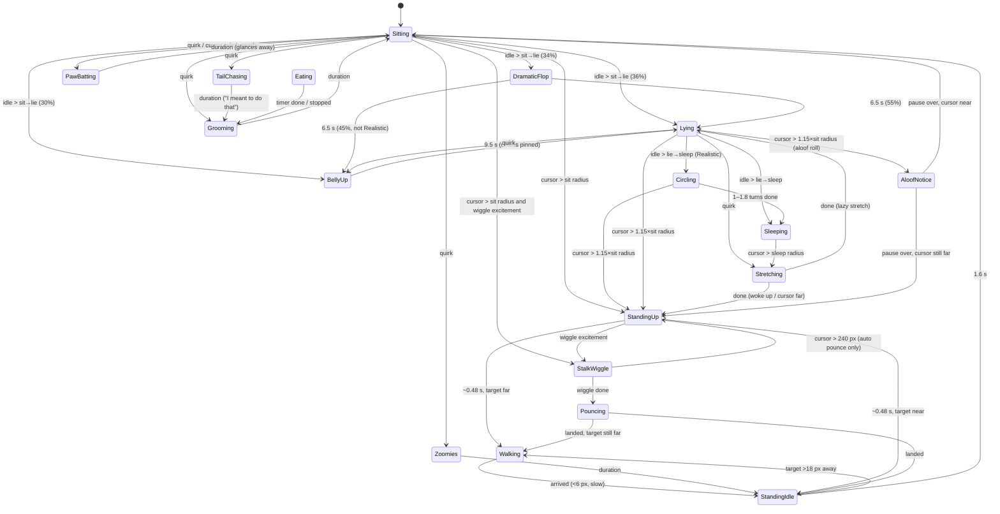

# Behavior

All behavior lives in `CatSim::update` in `src/cat/behavior.rs`. It's a single `Activity` state machine that runs once per frame on the cursor position and `dt`. Every distance listed below is in **unscaled pixels** and gets multiplied by `cat.scale` in the code.

## The pieces of state that drive decisions

| Field | Meaning |
|---|---|
| `raw_cursor` | This frame's cursor position. Used for wiggle and shake detection |
| `smooth_cursor` | Low-pass filtered cursor (rate 6.0/s, or 8.5/s while sprinting). The cat walks toward this, so small jitter from typing or clicking is ignored |
| `rest_target` | Where the cat is heading: a point `stop_radius` short of the cursor, so the cat doesn't cover the pointer |
| `wake_anchor` | Set after an eating session, a groom or a test trigger. While it's set, "distance to cursor" means **how far the cursor has moved since the anchor**, not how far the cat is from it. That's why the cat stays put after eating even when the cursor is across the screen, until you actually move the mouse |
| `idle_time` | Builds up while resting and is **not** reset between Sitting → Lying, so the "lie → sleep" time counts total idle time |
| `play_excitement` | Built up by laser-pointer-style wiggles. Leads to a pounce |
| `shake_energy` / `sprinting` | Built up by fast left-right mouse shakes. Leads to a gallop |
| `pinned_rest` | Set only by the test-only `BellyUp` trigger. Keeps BellyUp from timing out |

If **Follow Cursor** is off, the distance to the cursor is always treated as 0. The cat never wakes up or walks because of the cursor.

## State diagram

Not shown in the diagram: Grooming, PawBatting and TailChasing all go to `StandingUp` when the cursor moves past their wake radius (1.05×, 1.0× and 1.2× the sit radius). A sprint forces any state into `Walking`.

## Wake radii

| Situation | Wakes when the cursor is farther than |
|---|---|
| Walking stops at (`stop_radius`) | 38 × stop mult |
| Sitting, PawBatting | 72 × sit mult |
| Grooming | 72 × sit mult × 1.05 |
| Lying, DramaticFlop, BellyUp | 72 × sit mult × 1.15 |
| TailChasing | 72 × sit mult × 1.2 |
| Sleeping | 92 × sleep mult |

## Temperaments

| | stop mult | sit mult | sleep mult | sit→lie | lie→sleep | aloof chance | speed | quirk rate |
|---|---|---|---|---|---|---|---|---|
| **Balanced** | 1.00 | 1.00 | 1.00 | 12 s | 28 s | 28% | 1.00× | 1.00× |
| **Playful** | 0.85 | 0.80 | 0.80 | 18 s | 40 s | 8% | 1.22× | 1.65× |
| **Lazy** | 1.05 | 1.55 | 1.60 | 5.5 s | 12 s | 45% | 0.78× | 0.55× |
| **Aloof** | 1.35 | 1.30 | 1.25 | 11 s | 26 s | 65% | 0.90× | 0.75× |
| **Realistic** | 1.00 | 1.00 | 1.10 | 45 s | 120 s | 35% | own cruise, 1.00× sprint | 0.45× |

**Realistic** aims for real-cat pacing rather than a personality. The cat is ~45 px long, so 1 px is about 1 cm. It walks at 66 px/s (~0.65 m/s at ~1.6 strides/s, a relaxed cat walk) instead of 104, and trots at up to 135 px/s only toward distant targets. It settles slowly and fidgets rarely. Its sprint speed is the same as Balanced. The other temperaments scale a brisker walk and trot (104/152 px/s) by their speed multiplier, which also scales the sprint.

Temperament also sets how fast wiggles build `play_excitement`: Playful 2.5, Balanced 1.8, Realistic 1.5, Aloof 1.1, Lazy 0.9. "Aloof chance" is the probability that a lying cat first goes into `AloofNotice` (a 0.22–0.38 s ear-flick pause) before getting up. It only applies when the cursor is within 210 px.

## Cursor gestures

### Laser-pointer wiggle → pounce

A frame counts toward `play_excitement` only if **all** of these are true:
- Playful Hunting is on.
- The cursor step is longer than 4 px and **reverses** direction (dot product < −0.25 with the previous step direction).
- The instantaneous speed is over 250 px/s, and the step is under 75 px.
- The cursor is 75–230 px from the cat's head.

A step of 75 px or more, or a cursor 230 px or more from the head, resets excitement to 0. Otherwise excitement decays at 0.65/s. Once excitement is above **0.55** and the cursor is 85–230 px away, a Sitting or StandingUp cat goes into `StalkWiggle`, a low crouch with flattened ears. It lasts 0.6–0.85 s, or 1.4–2.4 s for Realistic. The cat holds a still stare for the first 30% of the crouch, then the butt wiggle fades in: weight shifting between the hind paws at about 3 Hz, right up to the launch. Then it goes into `Pouncing`, a leap of at most 180 px (90 px, about two body lengths, for Realistic; a cat with farther to go lands short and walks the rest). The leap follows `pounce_travel`, a trapezoidal speed profile: a hard push-off over the first 20%, steady flight, then braking over the last 25% as the forepaws land.

> The reversal requirement is deliberate (commit `2c02ff9`). Before it, a sudden point-to-point mouse move counted as excitement and made the cat do a straight-line pounce across the screen. Normal moves must always lead to a walk.

### Left-right shake → gallop

- A *horizontal step* is |dx| > 2.5 px, |dx| ≥ 0.75·|dy|, and vx > 180 px/s.
- Steps in the same direction add up into a *stroke*. When the direction reverses, the previous stroke counts if it covered ≥ 12 px and peaked above 240 px/s. Each counted stroke adds **0.68** `shake_energy` (capped at 2.0).
- Energy decays at 1.35/s. The stroke resets after 0.25 s with no horizontal steps, or after a large vertical move.
- At `shake_energy ≥ 1.0`, so about two quick reversals, `sprinting` turns on. Any state is forced into `Walking` with turning and acceleration tuned for a gallop, and `gallop_weight` blends in (see [animation.md](animation.md#gaits)). Sprinting ends once the cat has stopped and its energy has run out. Shakes are ignored while the cat is eating or when Follow Cursor is off.

## Spontaneous quirks

`tick_relaxing_quirks` runs while the cat is Sitting or Lying (and in Flop or BellyUp unless pinned).

1. **Paw-bat on twitch:** if a Sitting cat sees a small cursor move (1.5–28 px) within 52 px, there's an 18% chance per frame that it bats at the cursor with the paw on that side.
2. **Ear twitches:** any cursor move over 3 px has a 25% chance per frame of flicking one ear.
3. **Timer quirks:** `next_quirk_timer` counts down at the temperament's quirk rate. When it reaches zero, the code rolls a random number and checks these branches **in order**. A roll that fails a branch's condition falls through to the next branch:

| roll < | condition | result |
|---|---|---|
| 0.28 | — | ear flick |
| 0.48 | Sitting, playful, cursor < 54 px | PawBatting |
| 0.72 | Sitting | Grooming (2.6–4.2 s) |
| 0.84 | Sitting, playful | TailChasing (1.3–2.1 s) |
| 0.93 | Lying | 52% BellyUp, else lazy Stretching |
| 0.97 | Sitting, playful | Zoomies (1.4–2.2 s) |
| else | — | switch which side the tail curls toward |

Because of the fall-through, a **Lying** cat ends up rolling BellyUp or Stretching on most rolls between 0.28 and 0.93.

### Realistic resting

The **Realistic** temperament replaces the restless parts of this with how real cats rest:

- **Sitting → lying** (after 45 s): 80% `Lying` (a loaf), 20% straight onto its side (`DramaticFlop`). It never rolls belly-up straight from sitting.
- **On its side** it stays there until it falls asleep or wakes up, instead of moving on after 6.5 s.
- **Lying quirks** (the 0.28–0.93 rolls) are mostly an ear flick. Otherwise it rolls onto its side (25%), stretches (20%) or, rarely, goes belly-up (10%), and the next quirk is 8–16 s away.
- **Falling asleep:** it gets up and turns once or twice on the spot (`Circling`, about one turn per 2.5 s around its torso) and then curls up in the direction it was turning.

## Test triggers

`CatSim::trigger(kind)` is `#[cfg(test)]`: the tests use it to put the cat straight into a state (there's no menu item for it). It clears any sprint, shake or feeding state, then:

| Trigger | Activity | Notes |
|---|---|---|
| Pounce | StalkWiggle (0.55 s) → Pouncing | Leaps toward the cursor (max 180 px, or 90 px for Realistic). If the cursor is already close, it leaps 95 px forward. It is never cancelled by distance |
| Chase Tail | TailChasing 2.0 s | Orbits a **fixed** centre (`window_anchor`), so it never drifts |
| Groom | Grooming 3.4 s | |
| Lie on Back | BellyUp, **pinned** | Stays on its back until the cursor moves |
| Sleep | Sleeping | Curled up. Wakes only when the cursor moves past the sleep radius |

Every trigger except Pounce **latches** `wake_anchor` on the next `update`, so the radii above are measured from where the cursor was when the trigger ran.

## Feeding

`FeedingPhase` sits alongside `activity`:

1. **Carrying:** `begin_bowl_placement` attaches the bowl to the cursor, and a resting cat stands up. The cat follows the bowl.
2. **WalkingToBowl:** `place_bowl(pos)` runs on left-click. The cat walks toward the bowl using a 10.2 px stop radius, ignoring the cursor. If the bowl is placed within 18 px of the head, it skips straight to eating.
3. **Eating:** starts when the head is within ~16.7 px. The bowl **stays where it was placed**, and the cat's waist anchor creeps forward until the eating pose lines up with it. The bowl drains as `1 − elapsed/duration`. The Unlimited preset stays full forever.

When the timer finishes, or on `stop_feeding()`, the phase is cleared and the cat grooms for 2.6 s with a fresh `wake_anchor`, then goes back to following. Keep-awake is active during WalkingToBowl and Eating. See [platform-notes.md](platform-notes.md#keep-awake-feeding-mode).

## Determinism

`CatSim` uses its own PCG-style RNG with a fixed seed (`rng_state`), and `update` clamps `dt` to [0.001, 0.05]. The same cursor path at the same `dt` always produces the same behavior. The tests in `src/cat/tests.rs` rely on this.
